# ⚡ Awesome Static Site Generators & Personal Portfolios 🌐

<p align="center">
  
</p>

<p align="center">
  <a href="https://github.com/ishandutta2007/Awesome-Awesome-Awesome"></a>
  <a href="https://discord.gg/jc4xtF58Ve"></a>
  <a href="https://github.com/ishandutta2007/Awesome-Static-Site-Generators-Personal-Portfolios/stargazers"></a>
  <a href="https://github.com/ishandutta2007/Awesome-Static-Site-Generators-Personal-Portfolios/network/members"></a>
  <a href="https://github.com/ishandutta2007/Awesome-Awesome-Awesome"></a>
  <a href="LICENSE"></a>
  <a href="https://github.com/ishandutta2007"></a>
</p>

A curated directory of **Static Site Generators (SSGs)** 🚀, **Jamstack edge deployment platforms** ☁️, **developer portfolio templates** 🎨, **headless Git-based CMS engines** 📝, and **local-first web publishing tools** 💻. Built for frontend engineers, content creators, technical writers, and indie hackers seeking blazing performance, zero-latency SEO scores, and complete data sovereignty.

---

## 📑 Table of Contents

- [📊 Sector Overview & Market Dynamics](#-sector-overview--market-dynamics)
- [☁️ SaaS & Hosted Deployment Platforms](#️-saas--hosted-deployment-platforms)
- [📦 Open-Source GitHub Projects](#-open-source-github-projects)
- [🛠️ Architecture Comparison & Cheat Sheet](#️-architecture-comparison--cheat-sheet)
- [🤝 How to Contribute](#-how-to-contribute)
- [💖 Support & Sponsorship](#-support--sponsorship)
- [📈 Star History](#--star-history)
- [📜 License](#-license)
- [⚠️ Disclaimer](#️-disclaimer)

---

## 📊 Sector Overview & Market Dynamics

The global static site generator and Jamstack hosting ecosystem is valued at approximately **$2.1 billion to $2.8 billion**, with projections indicating rapid expansion towards **$6.5+ billion** driven by cloud-edge computing, headless CMS adoption, and modern core web vitals mandates. The sector exhibits a **bifurcated, moderately concentrated structure** at the edge infrastructure and hosting layer—dominated by hyper-scale hyperscalers and edge specialized clouds like Cloudflare, AWS, Google Cloud, and Vercel—while the generator framework and CMS tooling layers remain **highly fragmented**, fostering rich open-source competition across Go, Rust, React, Vue, Python, and zero-framework JavaScript. 🌐📈

---

## ☁️ SaaS & Hosted Deployment Platforms

The following hosted platforms provide automated Git-driven deployments, worldwide content delivery networks (CDNs), serverless API routes, preview deployments, and custom domain SSL for static sites and Jamstack applications. Entries are sorted descending by company scale (market valuation / market capitalization).

| Platform | Company Scale (Valuation / Cap) | Pricing (Starting Paid Tier) | Free Tier Limits (Free Forever or Trial) | Description |
| :--- | :--- | :--- | :--- | :--- |
| **[AWS Amplify Hosting](https://aws.amazon.com/amplify/hosting/)** | ~$2,100B Market Cap (Amazon AWS) | $0.01 per build minute; $0.15/GB served; $0.023/GB storage | **Free Tier (12 Months Free)**: 1,000 build minutes/month, 15 GB served/month, 5 GB storage | Fully managed CI/CD and static web hosting service backed by Amazon CloudFront edge network with branch previews and custom domains. ☁️ |
| **[Firebase Hosting](https://firebase.google.com/products/hosting)** | ~$2,050B Market Cap (Alphabet Google) | Pay-as-you-go (Blaze Plan): $0.15/GB transfer, $0.026/GB stored | **Free Forever (Spark Plan)**: 10 GB storage, 360 MB/day data transfer (approx. 10 GB/month), 1 custom domain with auto-provisioned SSL | Production-grade static and dynamic web content hosting powered by Google's global SSD CDN and CLI deployment rollbacks. 🔥 |
| **[Cloudflare Pages](https://pages.cloudflare.com/)** | ~$35B Market Cap (NYSE: NET) | $20/month (Pro Plan) | **Free Forever**: Unlimited bandwidth/traffic, unlimited static sites, 500 builds/month, 1 concurrent build | Ultra-fast Jamstack hosting platform running on Cloudflare's global edge network with built-in Cloudflare Workers integrations. ⚡ |
| **[GitHub Pages](https://pages.github.com/)** | ~$7.5B Acquisition Value (Microsoft subsidiary) | $4/user/month (GitHub Team plan for private repo hosting) | **Free Forever**: 1 GB storage limit per repo, 100 GB bandwidth/month, 10 builds/hour limit for public repositories | Zero-config static site hosting natively integrated into GitHub repos, supporting custom domains, HTTPS, and GitHub Actions CI/CD. 🐙 |
| **[Webflow](https://webflow.com/)** | ~$4.0B Valuation (Last private funding round) | $14/month billed annually ($18/mo monthly) for Basic Site Plan | **Free Forever (Starter Plan)**: webflow.io subdomain, 2 published static pages, 50 CMS items, 1 GB bandwidth | Visual website design and no-code hosting platform that exports clean HTML/CSS/JS with integrated global CDN hosting. 🎨 |
| **[Vercel](https://vercel.com/)** | ~$3.25B Valuation (Series D/E valuation) | $20/user/month (Pro Plan) | **Free Forever (Hobby Plan)**: 100 GB fast data transfer/month, 6,000 build minutes/month, non-commercial use | Cloud deployment and edge serverless platform from the creators of Next.js, featuring automated preview URLs and edge middleware. ▲ |
| **[Netlify](https://www.netlify.com/)** | ~$2.0B Valuation (Series D valuation) | $19/member/month billed annually ($24/mo monthly) for Pro Plan | **Free Forever (Starter Plan)**: 100 GB bandwidth/month, 300 build minutes/month, 500 form submissions/month | Pioneer Jamstack hosting platform offering Git-triggered continuous deployment, serverless edge functions, form handling, and identity. 🌐 |
| **[Framer](https://www.framer.com/)** | ~$1.0B Valuation (Estimated) | $10/site/month (Mini Plan) or $20/site/month (Basic Plan) | **Free Forever (Free Plan)**: framer.app subdomain, 1,000 visitors/month, 1 GB bandwidth, up to 10 CMS pages | Interactive design-to-web publishing tool designed for creating responsive personal portfolios and animations without coding. ✨ |
| **[Render](https://render.com/)** | ~$500M Valuation (Series B) | $19/month (Individual Developer Plan) | **Free Forever**: 100 GB bandwidth/month, 500 build minutes/month, unlimited static sites with automated SSL | Modern unified cloud host delivering static sites on a global CDN alongside containers, background workers, and PostgreSQL databases. 🚀 |

---

## 📦 Open-Source GitHub Projects

Curated open-source static site generators, documentation builders, headless CMS engines, and portfolio themes. Ranked in descending order by GitHub stargazer count. 🌟

| Project | GitHub_Stars | Primary Language / Stack | Description & Highlights |
| :--- | :--- | :--- | :--- |
| **[Next.js](https://github.com/vercel/next.js)** | [](https://github.com/vercel/next.js/stargazers) | React / TypeScript / Rust | The industry standard React framework featuring Static Site Generation (`output: 'export'`), Server-Side Rendering, and Turbopack compiler. ⚛️ |
| **[Hugo](https://github.com/gohugoio/hugo)** | [](https://github.com/gohugoio/hugo/stargazers) | Go | One of the fastest static site generators in existence; compiles thousands of Markdown files into static HTML in fractions of a second. ⚡ |
| **[Strapi](https://github.com/strapi/strapi)** | [](https://github.com/strapi/strapi/stargazers) | JavaScript / TypeScript | The leading open-source headless CMS. Fully customizable developer-first REST and GraphQL API for feeding static site builds. 🚀 |
| **[Docusaurus](https://github.com/facebook/docusaurus)** | [](https://github.com/facebook/docusaurus/stargazers) | React / MDX | Meta's documentation and portfolio static site generator featuring out-of-the-box search, versioning, localization, and MDX support. 🦖 |
| **[Coolify](https://github.com/coollabsio/coolify)** | [](https://github.com/coollabsio/coolify/stargazers) | PHP / Docker | Self-hostable, open-source PaaS alternative to Vercel and Netlify for deploying static sites, APIs, and databases on private servers. 🚢 |
| **[Astro](https://github.com/withastro/astro)** | [](https://github.com/withastro/astro/stargazers) | TypeScript / HTML | Content-first web framework with pioneering "Islands Architecture" that ships 0kB client-side JavaScript by default for maximum speed. 🚀 |
| **[Nuxt](https://github.com/nuxt/nuxt)** | [](https://github.com/nuxt/nuxt/stargazers) | Vue.js / TypeScript | The intuitive Vue framework with full static site generation capabilities (`nuxt generate`), file-based routing, and Nitro engine. 💚 |
| **[Gatsby](https://github.com/gatsbyjs/gatsby)** | [](https://github.com/gatsbyjs/gatsby/stargazers) | React / GraphQL | Pioneering static site framework featuring a unified GraphQL data layer and an extensive plugin ecosystem for image and asset optimization. 🟣 |
| **[Ghost](https://github.com/TryGhost/Ghost)** | [](https://github.com/TryGhost/Ghost/stargazers) | Node.js / JavaScript | Modern open-source publishing and membership platform, frequently self-hosted or paired headlessly with static site generators. 👻 |
| **[Jekyll](https://github.com/jekyll/jekyll)** | [](https://github.com/jekyll/jekyll/stargazers) | Ruby | The foundational blog-aware static site generator with native GitHub Pages integration, Liquid templating, and Markdown support. 🧪 |
| **[Slidev](https://github.com/slidevjs/slidev)** | [](https://github.com/slidevjs/slidev/stargazers) | Vue / Vite / Markdown | Developer presentation slides and developer talk showcases created purely in Markdown with interactive Vue components. 📊 |
| **[Payload CMS](https://github.com/payloadcms/payload)** | [](https://github.com/payloadcms/payload/stargazers) | TypeScript / Next.js | Modern headless CMS built natively on Next.js, providing instant admin panels, local SQLite/Postgres storage, and static generation hooks. 📦 |
| **[Hexo](https://github.com/hexojs/hexo)** | [](https://github.com/hexojs/hexo/stargazers) | Node.js / JavaScript | Fast, simple, and powerful blogging framework powered by Node.js with ultra-fast generation speeds and Markdown parsing. 📝 |
| **[Dokku](https://github.com/dokku/dokku)** | [](https://github.com/dokku/dokku/stargazers) | Shell / Docker | The smallest PaaS implementation you've ever seen; allows simple Git push deployments of static sites and full-stack services to any VPS. 🐳 |
| **[MkDocs Material](https://github.com/squidfunk/mkdocs-material)** | [](https://github.com/squidfunk/mkdocs-material/stargazers) | Python / HTML / Jinja | Beautiful Google Material Design documentation theme for MkDocs with search, dark mode, code annotations, and offline support. 🎨 |
| **[MkDocs](https://github.com/mkdocs/mkdocs)** | [](https://github.com/mkdocs/mkdocs/stargazers) | Python | Fast, simple, and thoroughly customizable static site generator geared directly towards project documentation and personal manuals. 📚 |
| **[mdBook](https://github.com/rust-lang/mdBook)** | [](https://github.com/rust-lang/mdBook/stargazers) | Rust | Rust's official command-line utility to create clean, searchable online digital books, course notes, and portfolios from Markdown. 📖 |
| **[Eleventy (11ty)](https://github.com/11ty/eleventy)** | [](https://github.com/11ty/eleventy/stargazers) | JavaScript | Zero-config, flexible JavaScript static site generator supporting Liquid, Nunjucks, WebC, and Markdown without forced client frameworks. 🎈 |
| **[Decap CMS](https://github.com/decaporg/decap-cms)** | [](https://github.com/decaporg/decap-cms/stargazers) | React / JavaScript | Open-source Git-backed headless content management system (formerly Netlify CMS) that enables browser-based editing directly to Git repos. ✍️ |
| **[VitePress](https://github.com/vuejs/vitepress)** | [](https://github.com/vuejs/vitepress/stargazers) | Vue 3 / Vite | Vite- and Vue-powered static site generator designed for ultra-fast Markdown documentation, technical blogs, and portfolio showcases. ⚡ |
| **[Zola](https://github.com/getzola/zola)** | [](https://github.com/getzola/zola/stargazers) | Rust | Zero-dependency, single-binary static site generator with built-in Sass compilation, Tera templates, and automated search indexing. 🦀 |
| **[Hugo PaperMod](https://github.com/adityatelange/hugo-PaperMod)** | [](https://github.com/adityatelange/hugo-PaperMod/stargazers) | Go HTML / CSS | Minimal, responsive, and ultra-popular Hugo theme created specifically for developer portfolios, personal blogs, and clean writing. 📰 |
| **[Nextra](https://github.com/shuding/nextra)** | [](https://github.com/shuding/nextra/stargazers) | Next.js / React | Simple, powerful, and flexible Next.js site generation framework combining MDX and filesystem-based routing for portfolios and docs. 📑 |
| **[TinaCMS](https://github.com/tinacms/tinacms)** | [](https://github.com/tinacms/tinacms/stargazers) | TypeScript / React | Fully open-source Git-backed headless CMS that brings real-time visual editing and Markdown syncing directly into Next.js/React projects. 🦙 |
| **[Quartz](https://github.com/jackyzha0/quartz)** | [](https://github.com/jackyzha0/quartz/stargazers) | TypeScript / Node.js | Fast, batteries-included digital garden and personal knowledge base builder that publishes Obsidian vaults and Markdown directly to the web. 🌱 |
| **[Pelican](https://github.com/getpelican/pelican)** | [](https://github.com/getpelican/pelican/stargazers) | Python | Static site generator written in Python supporting Markdown and reStructuredText syntax with Jinja2 theming and RSS/Atom feeds. 🐍 |
| **[Jekyll Theme Chirpy](https://github.com/cotes2020/jekyll-theme-chirpy)** | [](https://github.com/cotes2020/jekyll-theme-chirpy/stargazers) | Ruby / Jekyll | Feature-rich, highly rated minimal Jekyll theme designed specifically for technical writers, software engineers, and portfolio blogs. 🐦 |
| **[Starlight](https://github.com/withastro/starlight)** | [](https://github.com/withastro/starlight/stargazers) | Astro / TypeScript | Accessible, fast documentation and knowledge-base framework built on Astro with integrated Pagefind static search, i18n, and dark mode. ⭐ |
| **[Gridsome](https://github.com/gridsome/gridsome)** | [](https://github.com/gridsome/gridsome/stargazers) | Vue.js / GraphQL | Jamstack framework for Vue.js that connects any CMS, Markdown files, or external APIs to build lightning-fast progressive web apps. ⚡ |
| **[Publii](https://github.com/GetPublii/Publii)** | [](https://github.com/GetPublii/Publii/stargazers) | Electron / JavaScript | Offline desktop GUI CMS for Windows, macOS, and Linux that generates static websites and syncs with GitHub Pages, Netlify, or AWS S3. 🖥️ |
| **[Pagefind](https://github.com/CloudCannon/pagefind)** | [](https://github.com/CloudCannon/pagefind/stargazers) | Rust / WebAssembly | Fully static search library that indexes pre-built static websites into compact WebAssembly shards requiring zero runtime server. 🔍 |
| **[Cobalt](https://github.com/cobalt-org/cobalt.rs)** | [](https://github.com/cobalt-org/cobalt.rs/stargazers) | Rust | High-performance, simple static site generator written in Rust with Liquid templating, Sass support, and single-executable deployment. ⚙️ |
| **[Docusaurus OpenAPI Docs](https://github.com/PaloAltoNetworks/docusaurus-openapi-docs)** | [](https://github.com/PaloAltoNetworks/docusaurus-openapi-docs/stargazers) | TypeScript / React | Docusaurus plugin that generates interactive API reference documentation and personal developer sandbox explorers from OpenAPI specs. 🦝 |
| **[Janas](https://github.com/prabanta-dev/janas)** | [](https://github.com/prabanta-dev/janas/stargazers) | Pure C | Zero-dependency local AI inference engine and server ideal for privacy-focused offline content drafting and local automated site workflows. 🧠 |

---

## 🛠️ Architecture Comparison & Cheat Sheet

Choosing the optimal stack depends on your templating preference, build speed requirements, and deployment goals:

| Use Case | Recommended SSG Framework | Recommended Deployment Host | Search & CMS Companion |
| :--- | :--- | :--- | :--- |
| **Minimal Dev Portfolio & Blog** 💻 | [Astro](https://github.com/withastro/astro) or [Hugo](https://github.com/gohugoio/hugo) | [Cloudflare Pages](https://pages.cloudflare.com/) or [GitHub Pages](https://pages.github.com/) | Built-in / [Pagefind](https://github.com/CloudCannon/pagefind) |
| **Obsidian / Digital Garden** 🌱 | [Quartz](https://github.com/jackyzha0/quartz) | [GitHub Pages](https://pages.github.com/) or [Vercel](https://vercel.com/) | Built-in Quartz search |
| **Technical API & Documentation** 📚 | [Docusaurus](https://github.com/facebook/docusaurus) or [Starlight](https://github.com/withastro/starlight) | [Vercel](https://vercel.com/) or [Netlify](https://www.netlify.com/) | Algolia DocSearch / Pagefind |
| **Interactive React/Vue App + Portfolio** ⚡ | [Next.js](https://github.com/vercel/next.js) or [Nuxt](https://github.com/nuxt/nuxt) | [Vercel](https://vercel.com/) or [Render](https://render.com/) | [Payload CMS](https://github.com/payloadcms/payload) / [TinaCMS](https://github.com/tinacms/tinacms) |
| **Completely Offline Desktop CMS** 🖥️ | [Publii](https://github.com/GetPublii/Publii) | [GitHub Pages](https://pages.github.com/) | Built-in local search |
| **Self-Hosted Independent Server** 🔒 | [Zola](https://github.com/getzola/zola) or [Hugo](https://github.com/gohugoio/hugo) | [Coolify](https://github.com/coollabsio/coolify) on VPS | [Decap CMS](https://github.com/decaporg/decap-cms) |

---

## 🤝 How to Contribute

1. Fork this repository 🍴.
2. Create a descriptive branch: `git checkout -b add/my-awesome-tool` 🌿.
3. Add the project or platform to the respective table keeping the sorted criteria intact ✍️.
4. Ensure the GitHub_Stars_Badge follows the format:
   ```markdown
   [](https://github.com/<owner>/<repo>/stargazers)
   ```
5. Submit a Pull Request with a succinct explanation of why the tool benefits the static site and portfolio developer ecosystem 🚀.

---

## 💖 Support & Sponsorship

Thank you so much for exploring and using this list! If you found this directory helpful for discovering static site generators, developer portfolio platforms, or Jamstack hosts:

- ⭐ **Star this repository** to help others find it on GitHub.
- 🍴 **Fork and share** it with your developer community and friends.
- ☕ **Buy me a coffee & support ongoing curation**: Consider sponsoring via the [GitHub Sponsors Dashboard](https://github.com/sponsors/ishandutta2007) to help maintain and keep this ecosystem list up to date!

---

##  Star History
#[](https://star-history.dera.page/#ishandutta2007/Awesome-Static-Site-Generators-Personal-Portfolios&type=date&legend=top-left)
[](https://www.star-history.com/#ishandutta2007/Awesome-Static-Site-Generators-Personal-Portfolios&type=date&legend=top-left)

---

## 📜 License

Distributed under the [MIT License](LICENSE). ⚖️

---

## ⚠️ Disclaimer

- This is a community-curated list maintained for educational, reference, and developer productivity purposes.
- All brand names, logos, and trademarks referenced belong to their respective corporate and open-source owners.
- When deploying to static site hosting providers, verify current bandwidth allowances, build execution minutes, and commercial-use policies.
